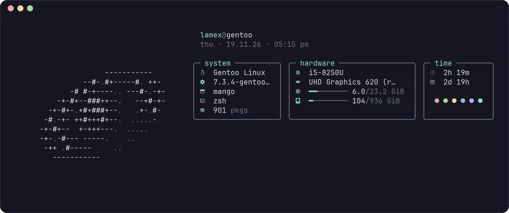
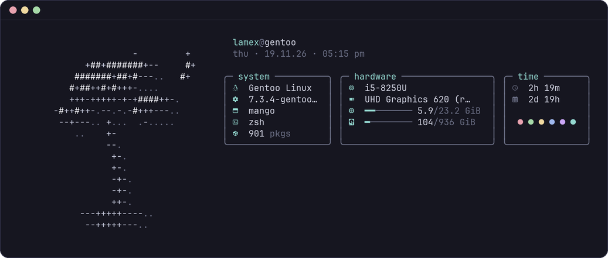
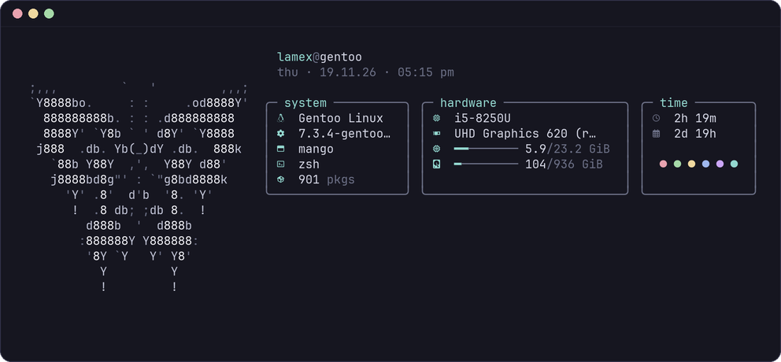
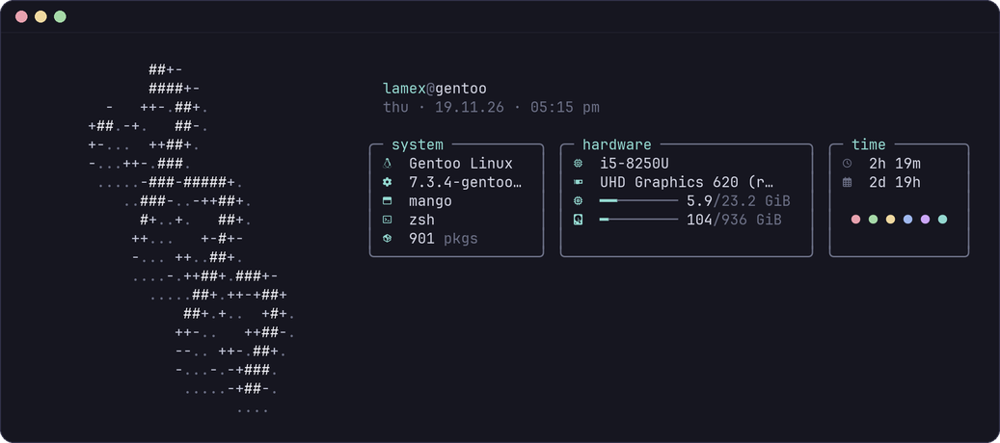
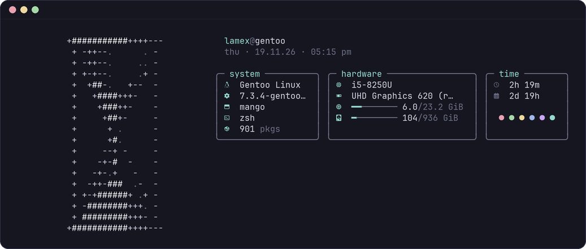
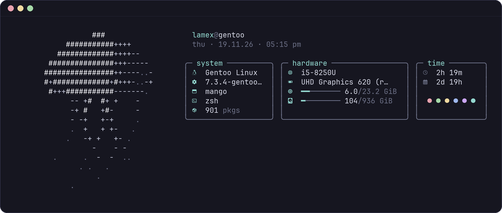
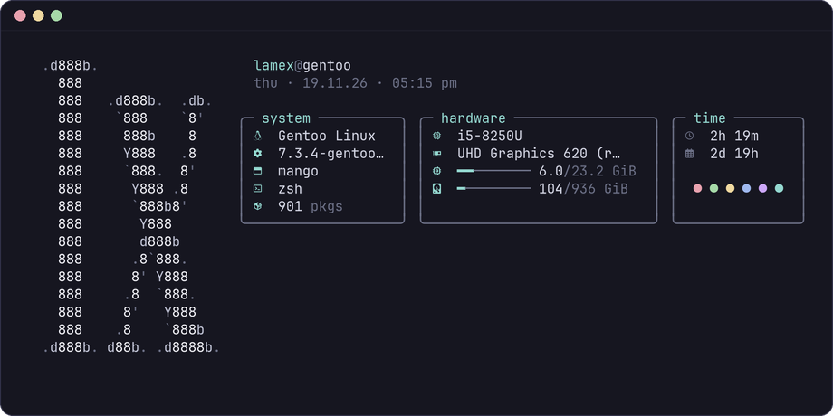
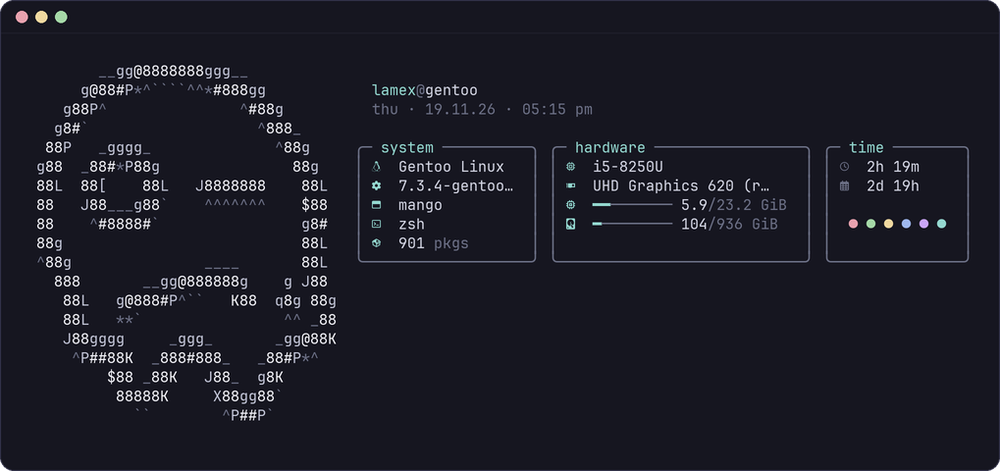

# fastfetch-cards

A fastfetch wrapper that prints system info as three rounded cards (**system**, **hardware** and **time**) next to a random ASCII art. Colours come from your terminal's 16-colour palette, so the output follows your terminal theme.



## Install

```sh
git clone https://github.com/lamex30/fastfetch-cards
cd fastfetch-cards
./install.sh
```

The installer copies the script to `~/.local/bin/fastfetch` and the arts to `~/.config/fastfetch/art/`. If `~/.local/bin/fastfetch` already exists, it is moved to `fastfetch.bak` first. `./install.sh --uninstall` removes everything and puts the backup back.

**Requirements**
- `python3`
- a [Nerd Font](https://www.nerdfonts.com/) in the terminal (for the icons)
- `~/.local/bin` placed before `/usr/bin` in `PATH`
- optional: the real `fastfetch`, for passthrough options. Anything the wrapper doesn't handle (`-l arch`, `--help`, `-c config.jsonc` …) is passed on to it.
- optional: `lspci` (pciutils), for the GPU name

## Usage

| command | what it does |
|---|---|
| `fastfetch` | random art, never the same one twice in a row |
| `fastfetch -a saturn` / `fastfetch saturn` | a specific art |
| `fastfetch --list-arts` | list the available arts |
| `fastfetch -l arch` | anything else goes to the real fastfetch |

On a narrow terminal the art is hidden and the cards wrap onto new rows.

**Adding your own art:** drop a `name.txt` into `~/.config/fastfetch/art/` (ANSI colours are allowed). It joins the random rotation right away. To use another directory, set `FASTFETCH_CARDS_ART_DIR`.

The package count supports portage, pacman, dpkg, apk, xbps and rpm. The OS icon is picked from `/etc/os-release` and falls back to Tux. You can override it with `FASTFETCH_CARDS_OS_ICON`.

## Arts

### bonsai


### butterfly


### dna


### hourglass


### jellyfish


### lx


### saturn


### smiley


## Screenshots

The images in `screenshots/` are rendered from the script's real output with `tools/render.py` (Pillow + JetBrainsMono Nerd Font):

```sh
script -qc "stty cols 120 rows 40; ./fastfetch -a saturn" /dev/null | tr -d '\r' | tools/render.py saturn.png
```
